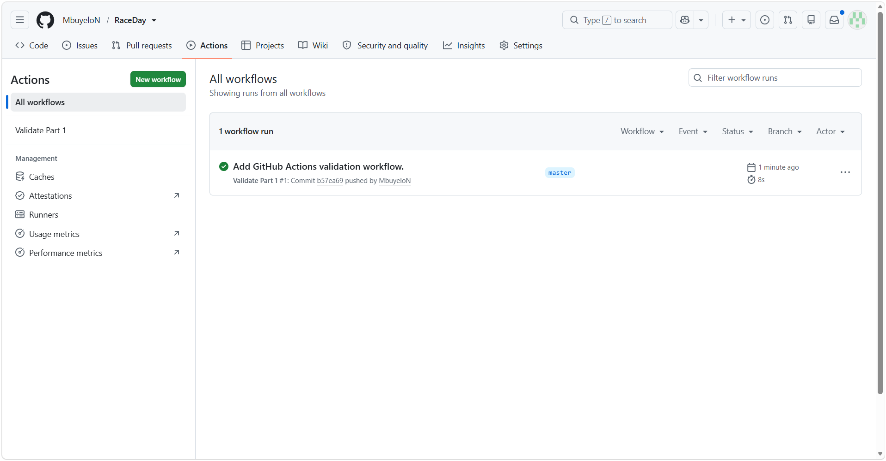
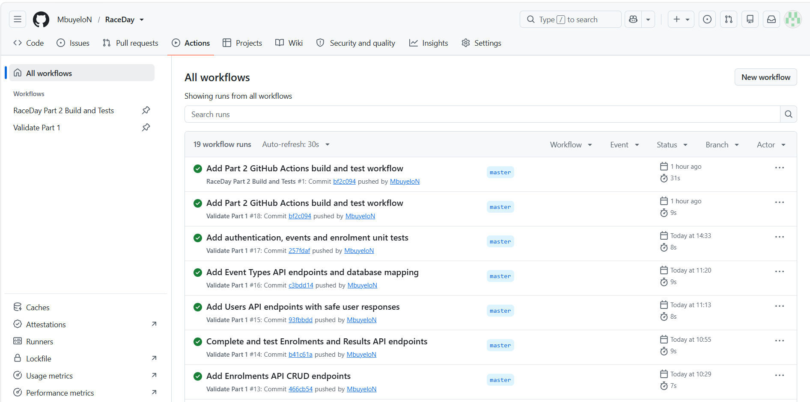

# RaceDay
**Programming 2B – Portfolio of Evidence (POE)**

## Project Overview

RaceDay is a web-based sporting event management system designed for South African running, walking and cycling events.

The application allows participants to browse and register for sporting events, while organisers can create and manage their own events.

RaceDay was developed using ASP.NET Core MVC, ASP.NET Core Web API, C#, Entity Framework Core and SQL Server.

## Project Structure

The solution consists of three main projects:

- **RaceDay.API** – Handles REST API endpoints, business logic and database operations.
- **RaceDay.MVC** – Provides the web interface for participants and organisers.
- **RaceDay.API.Tests** – Contains automated unit tests.

## Part 1 – System Planning and Database

Part 1 focused on planning the RaceDay system before development.

The planning documents include:

- Entity Relationship Diagram (ERD)
- API Endpoint Plan
- SQL Server Database Script
- GitHub Actions Validation Workflow

These documents are stored in the `/docs` folder.

### Part 1 CI/CD Validation

GitHub Actions was used to validate the required Part 1 files.

### Part 1 Video Presentation

https://youtu.be/cWrbEoW9MFA

## Part 2 – REST API Development

Part 2 focused on developing the backend REST API using ASP.NET Core, C#, Entity Framework Core and SQL Server.

### API Controllers

The API includes controllers for:

- Authentication
- Users
- Events
- Event Types
- Categories
- Enrolments
- Results

The API supports HTTP methods such as GET, POST, PUT and DELETE for retrieving and managing information.

### Authentication and Security

RaceDay uses password hashing to protect user passwords.

Session-based authentication stores the logged-in user's ID and role.

Role-based access restrictions help ensure that participants and organisers can only perform permitted operations.

Organisers can update and delete only events that belong to them.

### Database Integration

Entity Framework Core is used to communicate with the SQL Server database.

The database stores information about users, events, event types, categories, enrolments and results.

## Part 3 – ASP.NET Core MVC Application

The RaceDay MVC application provides a user-friendly interface that communicates with the REST API.

### Participant Features

Participants can:

- Register an account and log in.
- View available sporting events.
- Select event categories.
- Register for sporting events.
- View their existing registrations.
- Access the race results page.

### Organiser Features

Organisers can:

- Register an account and log in.
- Access the Organiser Dashboard.
- Create new sporting events.
- View events they have created.
- Edit their own events.
- Delete their own events.

The Manage Events functionality was tested through the MVC application, including creating, updating and deleting a test event.

The Organiser Registrations and Manage Results interfaces are not yet fully implemented.

## Running the Project

1. Open the RaceDay solution in Visual Studio.
2. Ensure SQL Server LocalDB is installed.
3. Create the RaceDay database using the provided SQL script if it does not already exist.
4. Check the database connection string in `appsettings.json`.
5. Run the `RaceDay.API` project.
6. Run the `RaceDay.MVC` project to access the web interface.
7. Log in as a Participant or Organiser to test the available features.

The MVC application requires the API to be running.

## API Documentation

Swagger/OpenAPI is included to display the available API endpoints and support API testing.

## Unit Testing

The project includes automated unit tests developed using xUnit.

To run the tests:

1. Open the solution in Visual Studio.
2. Select **Test → Test Explorer**.
3. Click **Run All Tests**.
4. Review the test results.

## GitHub and CI/CD

Git and GitHub were used for version control throughout development.

GitHub Actions is configured to build the project and run automated tests.

## Video Demonstrations

**Part 1 – System Planning and Database**

https://youtu.be/cWrbEoW9MFA

**Part 2 – REST API Development**

https://youtu.be/QcLGusuWkx8

**Final MVC Application Demonstration**

https://youtu.be/WZtaQ35stR4

## Conclusion

RaceDay demonstrates how ASP.NET Core MVC, Web API, Entity Framework Core and SQL Server can be combined to develop a sporting event management system.

The project includes user authentication, role-based access, event management, participant registration, API development, unit testing and GitHub integration.

The application provides a foundation for further improvements, including completing organiser registration management and race result administration.
