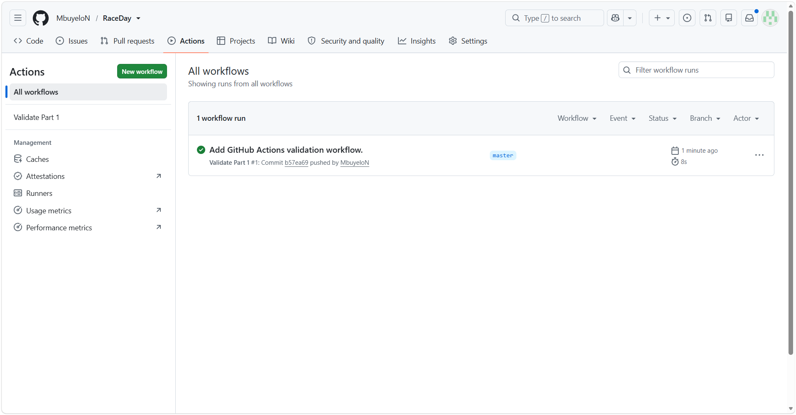
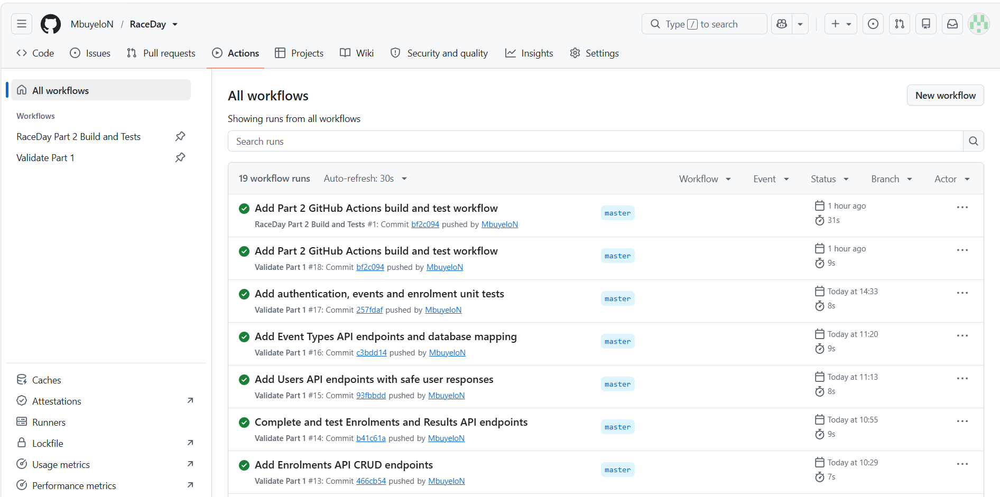

# RaceDay

RaceDay is a web-based event management system designed for South African road running, walking, and cycling events.

The system is designed to support two main user roles:

- **Organiser** – can create and manage events and categories, view event enrolments, and capture participant results.
- **Participant** – can create an account, browse events, enter an event by selecting a category, view their enrolments, and track their personal results.

## Part 1 - System Planning and Database

Part 1 focuses on planning the RaceDay system before application development begins.

The planning documents include:

- Entity Relationship Diagram (ERD)
- API Endpoint Plan
- SQL Server database script
- GitHub Actions validation workflow

These files are stored in the `/docs` folder.

## CI/CD Validation

The GitHub Actions workflow validates that the required Part 1 files are present in the repository.

## Video Presentation

YouTube video link: https://youtu.be/cWrbEoW9MFA

## Part 2 - REST API Development

Part 2 focuses on developing the RaceDay REST API using ASP.NET Core, C#, Entity Framework Core, and SQL Server.

### Main Features

The API supports two user roles:

- **Organiser:** Can create events, update or delete their own events, manage event information, and perform permitted event management activities.
- **Participant:** Can register, log in, view available events, enrol in events, and view their results.

The API includes endpoints for authentication, users, events, event types, categories, enrolments, and results.

### Authentication and Security

The system uses password hashing to protect user passwords. Session-based authentication stores the logged-in user's ID and role.

Role-based restrictions prevent Participants from performing Organiser-only activities.

### Running the Project

1. Open `RaceDay.API.slnx` in Visual Studio.
2. Ensure SQL Server LocalDB is available and the RaceDayDB database has been created using the project database script.
3. Check the database connection string in `appsettings.json`.
4. Run the RaceDay.API project.
5. Open Swagger to view and test the API endpoints.

### Unit Testing

The project includes automated unit tests using xUnit.

To run the tests, open Test Explorer in Visual Studio and select **Run All Tests**.

### CI/CD

GitHub Actions automatically builds the project and runs the unit tests to check that the API works correctly.

### Part 2 Video Presentation

YouTube video link: To be added after recording.
